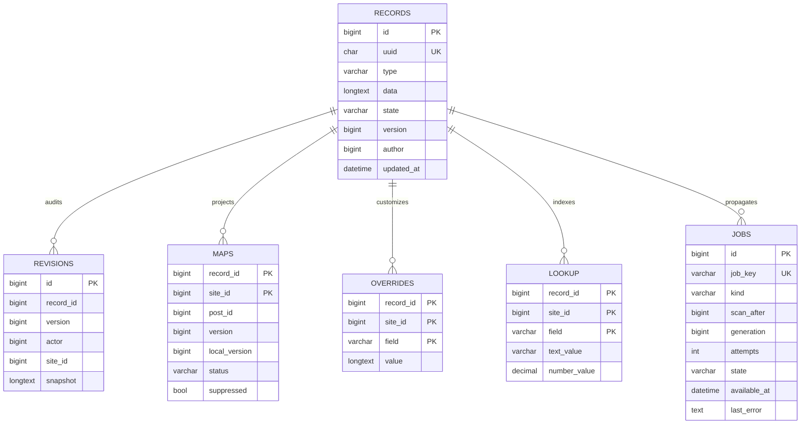
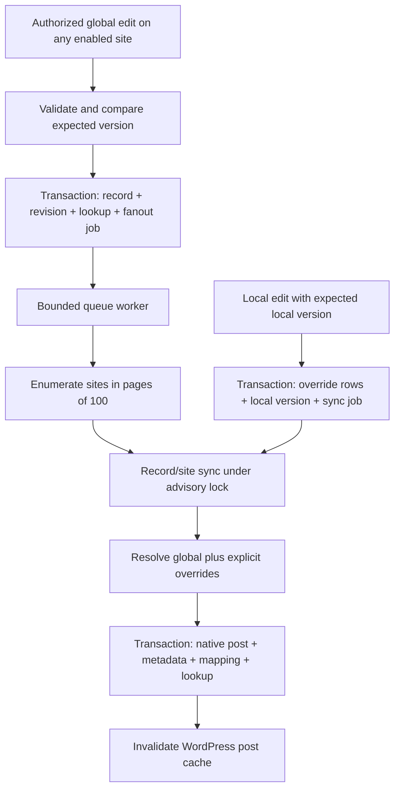

# Architecture and developer reference

## Data model

The authoritative model is a network record with UUID, schema type, JSON fields, lifecycle state, and monotonically increasing revision. Its numeric primary key is internal; relationships store the UUID. Native site posts are projections, not independent masters. Overrides are explicit rows keyed by record/site/field; row absence means inheritance. `array_replace` preserves intentional empty values.

All tables use `$wpdb->base_prefix . 'msc_' . get_current_network_id() . '_'` and InnoDB. Using the network ID prevents a second network in the same installation from sharing this network's catalog accidentally.



Maps enforce unique `(site_id,post_id)`, with nullable post IDs for removed/pending records. Record/site is the primary key. Global lookup rows use site ID zero; materialized effective lookup rows use a real site ID. Indexed `(site_id,field,text_value,record_id)` and numeric indexes support equality/range filters. Relationships use text indexes. Foreign keys are enforced in the service boundary rather than SQL constraints, consistent with WordPress's migration conventions.

## Save and propagation lifecycle



Global changes never loop synchronously through all subsites in the save request. Dedicated admin saves materialize only the editing site's post immediately for usability. Worker jobs coalesce by key and increment a generation when renewed. A worker acknowledges only its observed generation. Fanout and seed cursors use monotonic site/record IDs, not mutable offset pages. Worker crashes leave unacknowledged jobs for repeat execution. An exclusive advisory worker lock is released by MySQL when the connection dies; record/site locks also protect sync from duplicate post creation. Native writes and mappings share an InnoDB transaction; reserved `_msc_uuid` metadata provides an additional recovery lookup.

The PHP resolver observes current global data plus current local overrides. WordPress post properties/meta and effective indexes are eventually consistent. Do not mix those two read paths when a transactionally consistent cross-table snapshot is required. Queue failure does not roll back a committed global edit. Monitor mappings and queue state instead of presenting a queued revision as propagated. Local mutation writes an outbox job before immediate materialization, preserving recovery if materialization fails.

Authoritative reads bypass persistent caches to preserve compare-and-swap correctness. Override resolution uses a 300-second WordPress object-cache entry keyed by network, record ID, site, global revision, and local revision. Changed versions use a new key, avoiding stale-key deletion races. WordPress post caches are cleaned after sync. A persistent object-cache plugin is optional; native core request caching still works.

## Trusted PHP read API

These functions are intended for trusted server-side code. They do not implement an authorization boundary for arbitrary IDs; check publication and permissions before returning data to visitors.

| Function | Result |
|---|---|
| `msc_get_record($id, $site=null)` | Resolved record, global values, overrides, mapping; null if absent |
| `msc_get_field($id,$field,$site=null)` | Effective value; null if absent |
| `msc_get_global($id,$field)` | Authoritative global value |
| `msc_is_overridden($id,$field,$site=null)` | Explicit row-presence check |
| `msc_from_post($post_id,$site=null)` | Global record from native post |
| `msc_local_post_id($id,$site=null)` | Native ID or null |
| `msc_query($type,$filters=[],$site=null,$limit=50,$after=0)` | IDs matching indexed fields; site defaults current; zero selects global scope |
| `msc_related($id,$field,$site=null)` | Resolved target referenced by relationship UUID |
| `msc_episodes($show_uuid,$site=null,$limit=100)` | IDs ordered by season, episode, ID |
| `msc_seasons($show_uuid,$site=null)` | Season-number groups, bounded to 500 episodes |
| `msc_upcoming_episodes($show=null,$from=null,$site=null,$limit=20)` | IDs ordered by release date, season, episode |
| `msc_next_episode($show_uuid)` | First upcoming resolved episode or null |
| `msc_media_url($reference,$size='large')` | Owning site's attachment URL or fallback |

All IDs passed to resolver functions accept UUID or internal numeric ID unless named explicitly as post IDs/UUIDs. Query limits are clamped to 500. General indexed queries use ascending internal IDs and keyset `after`; date-sorted episode APIs are bounded and do not provide offset pagination. Upcoming means release date >= the supplied calendar date (defaults to the current site's date). Air time and time zone are stored and validated but are not converted into a network-wide UTC airing instant. A release-date filter can use `['release_date'=>['operator'=>'>=','value'=>'2027-01-01']]`. Supported operators are `=`, `>=`, `<=`, `>`, `<`. Empty/unknown unindexed fields are rejected.

Site-scoped query helpers include only maps whose publication preference is publish and not suppressed. Use them on enabled types; frontend renderers must also check actual native status and global lifecycle. PHP can intentionally read drafts for internal editorial services. The REST and block boundaries apply their own stricter checks.

## Mutations

```php
$store = \MSC\Plugin::store();
$record = $store->create('msc_show', ['title' => 'Example']);
$record = $store->update($record['uuid'], ['premiere_date' => '2027-01-10'], (int) $record['version']);
$map = $store->mapping((int) $record['id']); // wait/materialize first
$store->local($record['uuid'], ['seo_title' => 'Local headline'], [], (int) $map['local_version']);
$map = $store->mapping((int) $record['id']);
$store->local($record['uuid'], [], ['seo_title'], (int) $map['local_version']);
```

Mutations enforce current-user capabilities and current-site participation. Global update uses `UPDATE ... WHERE version=expected`, local mutation uses `local_version=expected`, and both reject stale writers. Supply fresh tokens for every save. `Store::revisions($id)` reads up to 100 newest snapshots. `restore($id,$revision,$expected)` creates a new data revision. `update($id,[],$expected,'trash'|'archived'|'active')` changes lifecycle and requires network administration plus MSC lifecycle capability. Permanent global deletion is unavailable.

Generic metadata writes to materialized fields and identifiers are rejected. Do not directly write `msc_*`, `_msc_uuid`, `_msc_baseline`, or `_msc_override_count` post metadata: these are materializations, not authoritative write APIs. Native title/content/excerpt/slug saves are captured as explicit local overrides. Native REST saves require `msc_expected_version`, available as `msc_state.local_version` in edit context. Gutenberg supplies it through the bundled middleware. Custom native REST clients must also supply it. Featured-media changes use the MSC local endpoint with explicit media ownership rather than an unscoped native attachment ID.

## REST API

Namespace: `/wp-json/msc/v1`. Use WordPress cookie authentication with `X-WP-Nonce`, or Application Passwords over HTTPS. WordPress handles authentication; each handler checks its capability and Store validates site/type scope. No cookie-authenticated write should omit the nonce.

| Method and path | Body/behavior |
|---|---|
| GET `/records?type=msc_show&limit=50&after=0` | Published current-site effective records; bounded keyset pagination |
| POST `/records` | `{type,data}`; Create Global |
| GET `/records/{uuid}` | Effective published values publicly; editors also receive global/override/mapping details |
| PATCH `/records/{uuid}` | `{version,data}`; Edit Global |
| PATCH `/records/{uuid}/local` | `{local_version,values,reset,status?}`; local permissions |
| POST `/records/{uuid}/lifecycle` | `{version,state}`; network lifecycle permission |
| GET `/records/{uuid}/revisions` | Edit Global; up to 100 snapshots |
| POST `/records/{uuid}/restore` | `{version,revision}`; restore data as new global revision |
| GET `/queue` | Network administration; pending/failed totals |

Validation errors return 400, capability errors 403, and stale updates 409. Unknown/unreadable single-record reads are forbidden. Lists never return authoritative global values or override internals. No cross-site override mutation parameter is accepted. PHP type checks and prepared queries protect the storage layer. Rich text uses `wp_kses_post` for all writers, including superadmins; scripts and unsupported HTML are removed while block comment structure remains.

## Fields, CPT extension, and hooks

See `examples/register-schema.php`. Built-in field types: text, richtext, slug, integer, number, date, time, timezone, boolean, select, multiselect, url, media, media_list, relationship, json. JSON is bounded by decoder depth on input but is otherwise schema-agnostic; nested key-specific validation requires an extension. Scalar min/max applies to numeric fields. Required-field and arbitrary cross-field validation are not implemented beyond the title schema definition.

Third-party field registration:

```php
add_action('msc_register_field_types', static function () {
    \MSC\Schema::register_type('rating', static function ($value, $field) {
        if (!is_numeric($value) || $value < 0 || $value > 10) {
            throw new \InvalidArgumentException('Rating must be 0–10.');
        }
        return (float) $value;
    });
});
```

The admin uses a text control for extension field types; custom control rendering is not exposed yet. Custom sanitizers must return JSON-safe values or throw. `msc_materialized($uuid,$site_id,$post_id,$global_version)` runs after writes and before transaction completion; callbacks must not send external side effects or throw casually. `msc_media_fallback_url($url,$reference)` supplies missing-media output. Register a media fallback with an HTTPS asset owned by your network.

ACF Free is optional. Version 1.1.0 includes generated supported-field groups, effective-value reads, local programmatic writes, and explicit-scope revisioned admin forms. See [the ACF adapter guide](acf.md) for the type matrix, relationship/date conversion, recursion prevention and unsupported complex/media fields. The network schema remains authoritative.

## Templates and Gutenberg

`examples/template-card.php` and `template-schedule.php` are functional, distinct renderers for a current native shared post; copy/include them from the relevant theme templates. Native `single-msc_show.php`, `archive-msc_show.php`, and normal `WP_Query` work. Local template selection remains a theme concern; this plugin does not force identical templates or store a universal layout.

The `msc/record` dynamic block accepts `{uuid}` and renders a linked title and synopsis using current-site values. It emits nothing for nonparticipating, draft/private, removed, or inactive records. Its editor has a UUID control and needs no Node build. Insert through Gutenberg or `<!-- wp:msc/record {"uuid":"..."} /-->`.

## Security and performance boundaries

Admin forms use action nonces, capability checks, escaped output, and safe redirects. REST uses WordPress authentication and endpoint authorization. The API stores JSON, never PHP serialization supplied by clients. SQL uses prepared values and fixed, internally generated table names. Lifecycle requires network authority and the admin UI additionally requires UUID confirmation. Local removal never touches global data. No automatic destructive uninstall exists.

Queue locks assume a single MySQL authority. Work is bounded by rows/jobs and a worker time budget, but an individual slow plugin callback can exceed that budget. Hooks from other plugins may send notifications on materialization; use `Materializer::$writing` to avoid synchronization recursion. Exact-once external side effects are not promised. Native post insertion, metadata, and mappings are transactional only when all participating tables use InnoDB.

The integration suite exercises 205-record catch-up and three subsites. It is not a benchmark of tens of thousands of records, dozens of sites, simultaneous real HTTP writers, sharded MySQL, or a persistent object cache. Benchmark those configurations in staging before rollout. Add retention, metrics, and production queue supervision appropriate to your network.
